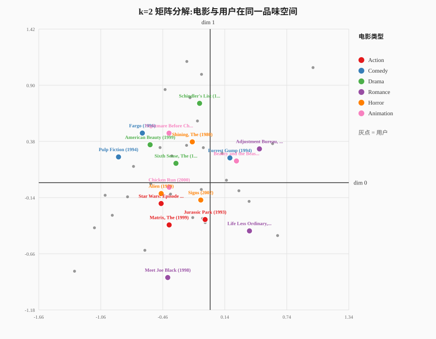

# MF 完全入门教程:从"填表格"到"品味空间"

> 目标读者:有 Java 后端/CRUD 经验、线性代数停留在"向量"层面、第一次接触矩阵分解的人。  
> 读完本文后,你能对着 `MatrixFactorization.java` 说出每一行在算什么,并且明白为什么 MF "预测评分准,但 Top-N 排序弱"。

---

## 0. 一句话钉住它

**MF 的全部思想:给每个用户、每部电影都算出一组"隐藏口味坐标",用两组坐标的匹配程度来预测评分。**

记住这句,下面全是在拆解它。

---

## 1. 诞生:一场 100 万美元的比赛

2006 年,Netflix 悬赏 **100 万美元**,要求把电影推荐准确度提升 10%。三年后夺冠的团队核心武器就是**矩阵分解**。

这件事的革命性在哪?

- **之前的主流是"邻居法"**(像 ItemCF):靠"看过 A 的人也看了 B"这种**统计共现**来推荐。
- **MF 第一次系统地用"学习参数"**:不数共现,而是**假设一个规律、解出规律**。

所以 MF 是推荐系统从"统计时代"迈向"机器学习时代"的分水岭。你学的不是一道数学题,是一次范式转变。

---

## 2. 问题本身:一张满是窟窿的 Excel 表

想象一张巨大的表格:

| | 星际穿越 | 泰坦尼克 | 战狼 |
|---|---|---|---|
| 你 | 5 | ? | ? |
| 甲 | 4 | 3 | ? |
| 乙 | ? | ? | 5 |

- 行 = 用户,列 = 电影,格子里 = 打分
- 真实世界里这张表可能有 **上亿个格子**,但用户只填了 **1%**,剩下 99% 是空的。

**推荐的任务就是:猜出这些空格子里他会打几分,然后把分最高的那些挑出来推给他。**

两种世界观:

- **ItemCF 的看法**:空格子不会凭空出现,我看"填过的格子"里谁和谁总一起出现。
- **MF 的看法**:别管邻居了。我赌这张表背后藏着一个简单规律。只要我把规律找出来,空格子自然能算出来。

MF 赌的是什么规律?往下看。

---

## 3. 核心思想:把人和电影放进同一个"品味空间"

### 3.1 地图上的坐标

假设每个人心里都有几条**隐藏的口味轴**,比如:

- 轴 1:爱"动作 / 刺激" ↔ 爱"文艺 / 慢节奏"
- 轴 2:爱"烧脑 / 深奥" ↔ 爱"轻松 / 娱乐"

于是:

- 每一部电影可以标一个坐标,比如《战狼》= `[0.9, 0.2]`(很动作,不太烧脑)
- 每一个用户也可以标一个坐标,比如你 = `[0.9, 0.1]`(超爱动作,不爱烧脑)

**一个人会不会喜欢一部电影 ≈ 这两个坐标"对不对得上"。**

怎么算"对得上"?用**点积**:

```
你喜欢《战狼》的程度 = 你的坐标 · 电影的坐标
                     = 0.9×0.9 + 0.1×0.2 = 0.83  → 高分,该推
你喜欢《文艺片》的程度 = 0.9×0.1 + 0.1×0.9 = 0.18  → 低分,不推
```

坐标**方向越一致,点积越大**,就代表越匹配。这就是"品味空间里的门当户对"。

### 3.2 相亲比喻

把用户和电影想成两拨参加相亲的人:

- 每个人有一份"属性清单"(坐标)
- 两人的清单越般配,总分越高

MF 就是**从"已有的几桩成功/失败的相亲记录"里,反推出每个人的属性清单**。

---

## 4. 可视化:我们亲手训出来的 k=2 空间

上面的比喻是二维的,MF 正好可以设 `k=2`,把坐标画出来。下面这张图是用本项目的 `MfVisualizer` 训练得到的真实结果。



### 4.1 这张图是怎么跑出来的

```bash
# 1. 训练 k=2 的 MF,导出用户/电影坐标和逐步预测
java -cp target/classes tour.recsys.demo.MfVisualizer data/ml-latest-small data/mf-2d-embedding.csv

# 2. 用零依赖 Python 脚本画 SVG
python3 scripts/plot_mf_2d.py data/mf-2d-embedding.csv docs/images/mf-2d.svg
```

代码位置:

- 训练并导出坐标:`src/main/java/tour/recsys/demo/MfVisualizer.java`
- 画图:`scripts/plot_mf_2d.py`
- 生成的数据:`data/mf-2d-embedding.csv`
- 生成的图:`docs/images/mf-2d.svg`

### 4.2 看图说话

- **彩色大点 = 电影**,颜色代表它的主类型(按 `movies.csv` 第一个 genre 划分)
- **灰色小点 = 用户**,活跃度最高的 30 人
- 横轴/纵轴 = 模型自己学出来的两个隐藏维度,**没有人类可解释的名字**

你能看到什么?

- **动作片(红色)** 整体偏向左下区域
- **喜剧/动画(蓝色/粉色)** 整体偏向右上区域
- 用户散落在空间里,有的离动作片簇近,有的离喜剧片簇近

这意味着模型确实抓到了一点"类型口味"的结构,但请注意:

> **这不是 genre 分类器。** 模型从来没看过"Action""Comedy"这些标签,它只是从评分模式里学到了这些簇。标签是我们事后贴上去帮助你看懂的。

### 4.3 为什么不能指望 k=2 分得特别清楚

我们只给模型 **2 个维度**,它必须用这两个数概括所有口味。真实世界显然不止两个维度,所以簇之间有重叠很正常。如果设 `k=100`,分类会更细腻,但图就画不出来了。

---

## 5. 逐步拆解:一次真实预测的五步

下面是 `MfVisualizer` 对 **user 414** 的两部电影的真实计算输出。你能在 `MatrixFactorization.java:94` 找到完全对应的代码。

### 5.1 电影 1:Heat (1995)

```
μ      = 3.5016   (所有人打分的平均水平)
b_u    = -0.0979  (user 414 的打分偏置)
b_i    = +0.4801  (这部电影的口碑偏置)
p_u    = [-0.7403, 0.1511]      ← 用户在品味空间里的坐标
q_i    = [-0.3531, -0.0596]     ← 电影在品味空间里的坐标
p_u·q_i= 0.2524                  ← 坐标点积 = 口味匹配分
r̂      = 3.5016 + (-0.0979) + 0.4801 + 0.2524 = 4.1361
真实评分 = 3.0
误差    = -1.1361
```

**解读**:模型预测 user 414 会给《Heat》打 **4.14 分**,但他实际只打了 **3.0 分**。预测偏高了。

为什么偏高?看坐标:

- 用户的坐标 `[-0.74, 0.15]` 和电影的坐标 `[-0.35, -0.06]` 方向大致一致(都在左侧),所以点积是正的 0.25。
- 加上电影本身的口碑偏置 `b_i=+0.48`(这片子整体口碑不错),预测就被拉到了 4.1。
- 实际用户比模型以为的"更不买账",所以误差为负。

### 5.2 电影 2:Grumpier Old Men (1995)

```
μ      = 3.5016
b_u    = -0.0979
b_i    = -0.2244                  ← 这部电影口碑偏置为负
p_u    = [-0.7403, 0.1511]
q_i    = [0.1741, 0.1884]         ← 这部电影在右侧,和用户方向不一致
p_u·q_i= -0.1004                  ← 点积为负,口味不匹配
r̂      = 3.5016 + (-0.0979) + (-0.2244) + (-0.1004) = 3.0788
真实评分 = 4.0
误差    = +0.9212
```

**解读**:模型预测 **3.08 分**,实际用户打了 **4.0 分**。预测偏低了。

为什么?用户坐标在左侧(`-0.74`),电影坐标在右侧(`0.17`),两者方向相反,点积是负的 `-0.10`。模型以为 user 414 不喜欢这部喜剧片,但他实际给了 4 分 —— 说明仅用二维坐标概括口味会犯错,也印证了 MF 的 HR@10 只有 2% 的原因:**它学的是评分预测,不是"能不能把用户真正喜欢的电影排进前 K"**。

### 5.3 公式与代码的一一对应

```
r̂_ui = μ + b_u + b_i + p_u · q_i
```

代码 `MatrixFactorization.java:94`:

```java
double pred = mu + bU[u] + bI[i] + dot(p[u], q[i]);
```

- `mu` → μ
- `bU[u]` → b_u
- `bI[i]` → b_i
- `dot(p[u], q[i])` → p_u · q_i

就是这么直接。

---

## 6. 最反直觉的一点:轴不是我们定的

你可能想问:那这两个维度到底代表"动作"和"文艺"吗?

**不。这是 MF 最漂亮的地方:这些轴是模型自己从数据里"猜"出来的,没有任何人告诉它,而且通常没有人类能看懂的名字。**

真实的隐藏维度可能是:

- "对 90 年代港片的怀旧"
- "对慢镜头的容忍度"
- "偏爱长片还是短片"
- 某种无法用语言描述的混合模式

你根本列不全,也标不准。所以 MF 干脆不列,让模型自己发现。

> 💡 类比:神经网络的神经元。**没人知道第 37 个维度具体是什么含义**,但它确实在起作用。**别纠结"某个维度代表什么",要看的是整个向量组合起来能不能预测准。**

---

## 7. 矩阵分解的字面意思:把大表拆成两个瘦矩阵

回到那张带洞的评分表 **R**(用户数 × 电影数)。MF 说:

```
R ≈ P × Qᵀ
```

- **P**:用户数 × k 的矩阵,第 u 行就是用户 u 的坐标
- **Q**:电影数 × k 的矩阵,第 i 行就是电影 i 的坐标
- 用户 u 对电影 i 的预测分 = P 的第 u 行 · Q 的第 i 行

```
        R (用户×电影, 大量空格)      ≈      P (用户×k)   ×   Qᵀ (k×电影)
       ┌─────────────┐                  ┌────────┐      ┌────────┐
   你  │ 5  ?  ?  ... │                  │ 0.9 0.1│      │ 0.9 0.1│ ←《战狼》
   甲  │ 4  3  ?  ... │        ≈         │ 0.2 0.8│  ×   │ 0.1 0.9│ ←《文艺片》
   乙  │ ?  ?  5  ... │                  │ 0.5 0.5│      └────────┘
       └─────────────┘                  └────────┘
       一亿个格子                        每个用户只要      每部电影只要
       (99% 是空的)                      k 个数            k 个数
```

**为什么这叫"分解"?** 原本是一个又大又稀的矩阵,现在被拆成两个又瘦又密的矩阵相乘。**信息被压缩了。**

**为什么压缩能"补洞"?** 因为压缩的前提是"这张表有内在的简单结构"。一旦模型抓住了这个结构,任何空格子都可以用 `P行 · Q行` 算出来。这就是 MF 能推荐"你没评价过的电影"的原理。

---

## 8. 怎么"猜"出这些坐标?—— 教小孩 + 摸黑下山

P 和 Q 全是未知数,怎么求?

### 8.1 白话版:先瞎猜,再微调

就像教小孩认东西:

1. 小孩先瞎说一个答案
2. 你告诉他错在哪、错了多少
3. 他往"错得更少"的方向挪一小步
4. 重复几万遍,越来越准

MF 也是这么干的。

### 8.2 损失函数:错得有多离谱

只看"已知的那些格子"(用户真正打过分的地方),比较预测分 vs 真实分,差得越多,损失越大。目标就是让这个损失尽量小:

```
L = Σ_{已知评分} (真实分 − 预测分)² + λ(‖p_u‖² + ‖q_i‖² + b_u² + b_i²)
```

第二项是**正则 λ**(代码里的 `reg`),防止坐标数字变得巨大、只背下了已知格子却不通用。

### 8.3 梯度下降:摸黑下山

想象你站在一座山上,山下是"损失最小"的谷底。你看不见全貌,但能感觉到脚下的坡度。

- 往下坡方向挪一小步 → 损失变小一点
- 反复挪,最终走到谷底

三个旋钮(对应代码参数):

| 旋钮 | 代码 | 白话 |
|---|---|---|
| 学习率 `lr` | `lr` | 步子多大。太大摔下山,太小走不到 |
| 正则 `reg` | `reg` | 别走极端。太大会把坐标压平 |
| 迭代轮数 `epochs` | `epochs` | 来回走几趟。太少没到底,太多会过拟合 |

### 8.4 代码里的更新长什么样

`MatrixFactorization.java:96-104`:

```java
bU[u] += lr * (e - reg * bU[u]);
bI[i] += lr * (e - reg * bI[i]);
for (int f = 0; f < k; f++) {
    double puf = pu[f];          // ← 必须先存旧值!
    double qif = qi[f];
    pu[f] += lr * (e * qif - reg * puf);
    qi[f] += lr * (e * puf - reg * qif);
}
```

**关键细节**:`p_u` 和 `q_i` 必须用彼此的旧值更新。如果先更新了 `p_u` 再更新 `q_i`,`q_i` 就用到了"被污染"的 `p_u`,SGD 会跑偏。这是手写 MF 最经典的 bug。

---

## 9. 偏置项:三个让预测更靠谱的修正

纯靠坐标点积太"干净"了,所以公式里有三个偏移:

```
r̂_ui = μ + b_u + b_i + p_u · q_i
```

| 项 | 含义 | 直觉 |
|---|---|---|
| μ | 全局均值 | "所有人都打 3.5 分"的基线 |
| b_u | 用户偏置 | 这人打分天生苛刻还是宽容 |
| b_i | 物品偏置 | 这部电影公认好还是烂 |
| p_u·q_i | 坐标点积 | 真正的个性化匹配 |

**为什么需要偏置?** 因为"某用户就是爱打高分"这件事和具体电影无关,如果让内积去硬扛它,会学得又慢又差。拆出来之后,内积只需要负责"你和别人不一样的口味",收敛大大加速。

在我们上面的例子中:

- `b_i(Heat) = +0.48` → 这片子口碑好,所有人都会多给一点
- `b_i(Grumpier Old Men) = -0.22` → 这片子口碑一般,所有人都会少给一点
- `b_u(user 414) = -0.10` → 这个用户打分略苛刻

---

## 10. 局限:不要神化 MF

回到阶段一的实测结果:

| 模型 | HR@10 | 角色 |
|---|---|---|
| ItemCF | 5.41% | 排序更好,但不能评分预测 |
| MF | 1.97% | 能评分预测,但排序弱 |

MF 的弱点来自它的**目标函数**:

- 它最小化的是**已观测评分**的误差
- 它从来没见过"负样本"(用户没评分的电影,可能是没看到,也可能是讨厌)
- 所以它在排序未观测物品时区分度很差

**"评分预测准"≠"排得靠前"** —— 这是推荐系统最经典的认知鸿沟,也是阶段二要用 **BPR(成对排序)** 解决的目标错配。

其他局限:

- **需要训练**,比 ItemCF 重,调参更敏感
- **冷启动**:新用户/新电影没有坐标,得靠偏置或额外特征兜底
- **单次推荐 O(物品数×k)**:适合在候选集上精排,不适合全量召回

---

## 11. 动手扩展

理解了本文后,你可以继续玩这几件事:

1. **把 k 从 2 改到 100**:看 RMSE 和 HR@10 如何变化(`Main.java` 里改 `new MatrixFactorization(...)` 的参数)。
2. **只保留偏置,把隐向量维度 k 设成 0**(或注释掉点积项):看 RMSE 会差多少,体会偏置本身有多重要。
3. **给 `MfVisualizer` 换一批电影**:在 `GENRES` 列表里改类型,看不同簇的位置。
4. **阶段二预告**:把平方误差换成 **BPR 成对损失**,让 MF 专门学习"用户喜欢的 > 用户不喜欢的",观察 HR@10 反超 ItemCF。

---

## 12. 关键代码索引

| 想看什么 | 文件:行号 |
|---|---|
| 预测公式 | `src/main/java/tour/recsys/model/MatrixFactorization.java:94` |
| SGD 训练主循环 | `src/main/java/tour/recsys/model/MatrixFactorization.java:88-107` |
| 隐向量初始化 | `src/main/java/tour/recsys/model/MatrixFactorization.java:73-83` |
| k=2 可视化导出 | `src/main/java/tour/recsys/demo/MfVisualizer.java` |
| 画图脚本 | `scripts/plot_mf_2d.py` |
| MF 与 ItemCF 对比评估 | `src/main/java/tour/recsys/Main.java` |

---

## 13. 参考

- Koren, Bell, Volinsky. "Matrix Factorization Techniques for Recommender Systems", IEEE Computer, 2009. https://ieeexplore.ieee.org/document/5197422
- Rendle et al. "BPR: Bayesian Personalized Ranking from Implicit Feedback", UAI 2009. https://arxiv.org/abs/1205.2618
- 王喆.《深度学习推荐系统》
- 项亮.《推荐系统实践》

---

**最后的自测题**:

1. 如果我把 `k` 从 2 调到 100,`P` 和 `Q` 矩阵的形状怎么变?训练时间怎么变?
2. `b_u` 和 `b_i` 分别解决什么问题?没有它们,模型会怎么样?
3. 为什么 MF 的 `recommend` 是 O(物品数×k),而 ItemCF 与物品总数无关?这对线上架构有什么启示?
4. 从本文图上看,动作片和喜剧片大致分布在哪个区域?这说明模型学到了什么?
5. 为什么 MF 的 RMSE 能从 1.13 降到 0.97,但 HR@10 只有 2%?这两个指标分别考核什么能力?
